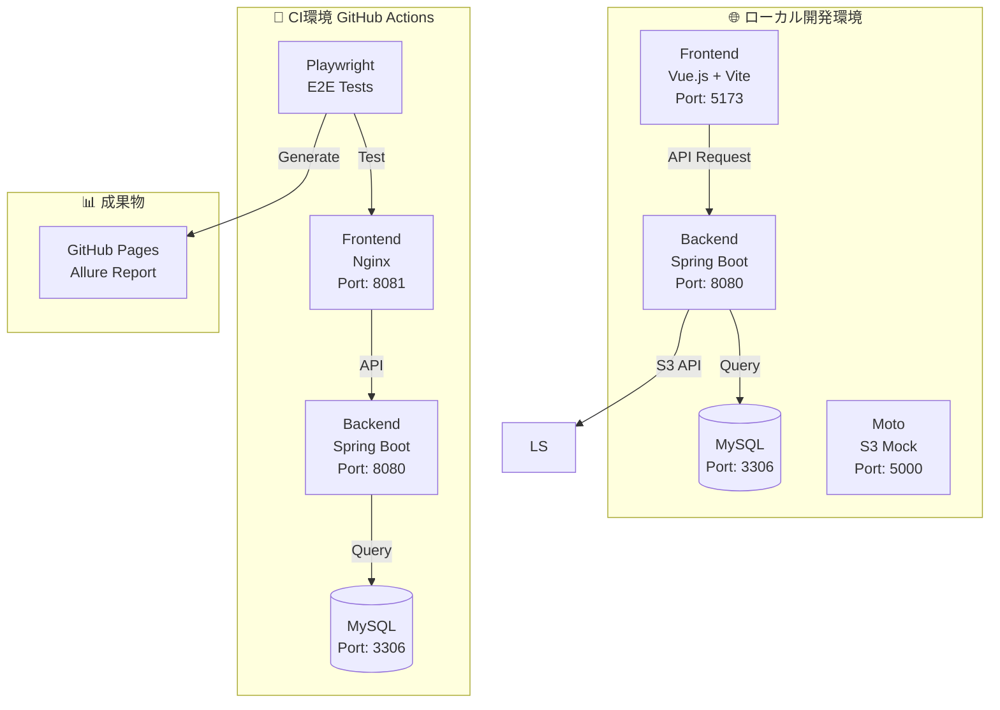
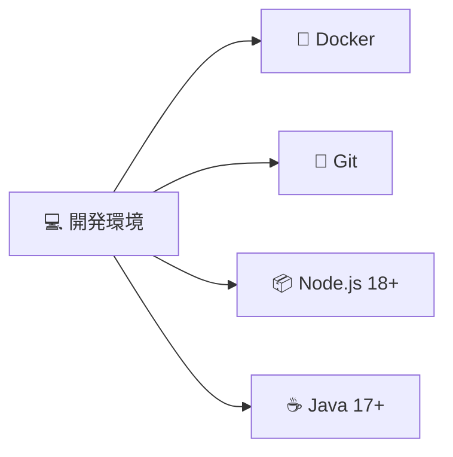
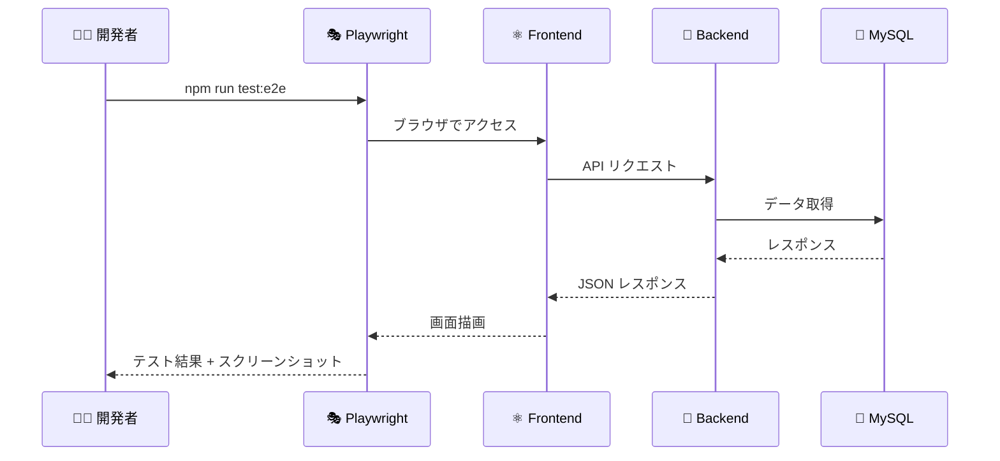
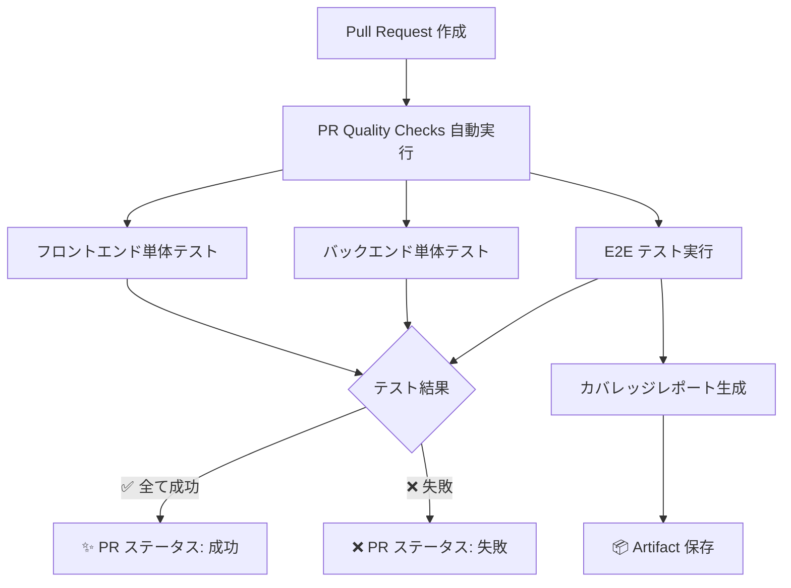
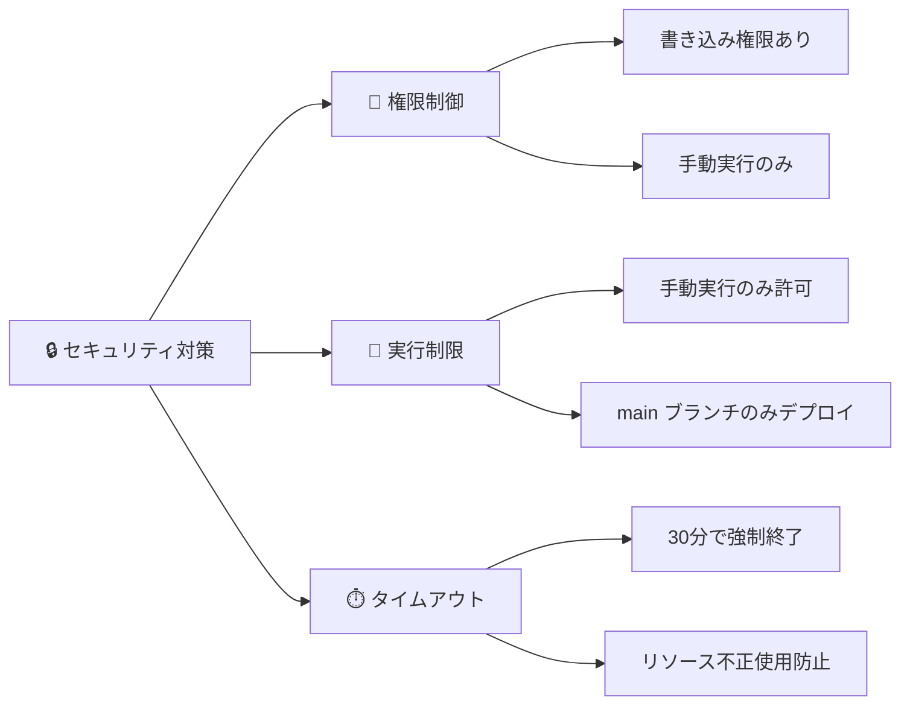
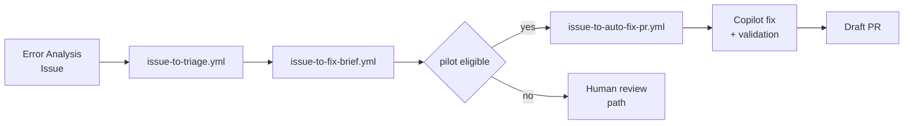

# 📱 Test App

> Spring Boot + Vue.js + Playwright による E2E テスト自動化アプリケーション

[](https://github.com/cocomomojo/test_app/actions/workflows/e2e.yml)
[](https://cocomomojo.github.io/test_app/allure/)
[](https://cocomomojo.github.io/test_app/coverage/)

---
---

## 📋 目次

- [📱 Test App](#-test-app)
  - [📋 目次](#-目次)
  - [🎯 プロジェクト概要](#-プロジェクト概要)
  - [🏗️ システム構成](#️-システム構成)
  - [🛠️ 技術スタック](#️-技術スタック)
  - [📦 環境構築](#-環境構築)
  - [🚀 ローカル実行](#-ローカル実行)
  - [🧪 E2E テスト実行](#-e2e-テスト実行)
  - [🔄 GitHub Actions（CI/CD）](#-github-actionscicd)
  - [📊 GitHub Pages（テストレポート・カバレッジ）](#-github-pagesテストレポート・カバレッジ)
  - [🔒 セキュリティ](#-セキュリティ)
  - [📚 参考資料](#-参考資料)

---

## 🎯 プロジェクト概要

このプロジェクトは、以下の機能を提供するフルスタック Web アプリケーションです：

- ✅ ユーザー認証（ローカル開発用の簡易認証実装）
- ✅ メモ管理（画像アップロード機能付き）
- ✅ ToDo 管理
- ✅ E2E テスト自動化（Playwright + Allure）
- ✅ CI/CD パイプライン（GitHub Actions）
- ✅ テストレポート自動公開（GitHub Pages）

---

## 🏗️ システム構成



### 📂 ディレクトリ構造

```
test_app/
├── 📁 backend/              # Spring Boot バックエンド
│   ├── src/
│   │   └── main/
│   │       ├── java/        # Java ソースコード
│   │       └── resources/   # 設定ファイル
│   ├── build.gradle         # Gradle 設定
│   └── Dockerfile           # Docker イメージ定義
│
├── 📁 frontend/             # Vue.js フロントエンド
│   ├── src/                 # Vue.js コンポーネント
│   ├── tests/e2e/           # E2E テスト（Playwright）
│   ├── package.json         # npm 依存関係
│   ├── playwright.config.ts # Playwright 設定
│   ├── nginx.conf           # Nginx 設定（本番用）
│   └── Dockerfile           # Docker イメージ定義
│
├── 📁 infra/                # インフラ設定
│   ├── docker-compose.local.yml  # ローカル開発用
│   ├── docker-compose.ci.yml     # CI 環境用
│
└── 📁 .github/
    └── workflows/
        └── e2e.yml          # GitHub Actions ワークフロー
```

---

## 🛠️ 技術スタック

### バックエンド
| 技術 | バージョン | 用途 |
|------|-----------|------|
| ☕ Java | 17 | プログラミング言語 |
| 🍃 Spring Boot | 3.5.9 | Web フレームワーク |
| 🔐 Spring Security | 3.5.9 | 認証・認可 |
| 💾 MySQL | 8.0 | データベース |
| ☁️ AWS SDK | 2.25.60 | S3 連携 |
| 📦 Gradle | - | ビルドツール |

### フロントエンド
| 技術 | バージョン | 用途 |
|------|-----------|------|
| 🖖 Vue.js | 3.3.4+ | UI フレームワーク |
| ⚡ Vite | 5.0+ | ビルドツール |
| 🎨 Vuetify | 3.3.0+ | UI コンポーネント |
| 🎭 Playwright | 1.40.0+ | E2E テスト |
| 📊 Allure | 2.13.9+ | テストレポート |
| 🌐 Nginx | Alpine | Web サーバー（本番） |

### インフラ
| 技術 | 用途 |
|------|------|
| 🐳 Docker | コンテナ化 |
| 🔧 Docker Compose | ローカル環境構築 |
| 🔄 GitHub Actions | CI/CD パイプライン |
| 📄 GitHub Pages | レポート公開 |

---

## 📦 環境構築

### 前提条件

以下のツールがインストールされていることを確認してください：



| ツール | 必須/推奨 | バージョン | 確認コマンド |
|--------|----------|-----------|-------------|
| 🐳 Docker | 必須 | 20.10+ | `docker --version` |
| 🔧 Docker Compose | 必須 | 2.0+ | `docker compose version` |
| 🐙 Git | 必須 | 2.30+ | `git --version` |
| 📦 Node.js | 推奨 | 18+ | `node --version` |
| ☕ Java | 推奨 | 17+ | `java --version` |

### 🔽 リポジトリのクローン

```bash
# リポジトリをクローン
git clone https://github.com/cocomomojo/test_app.git
cd test_app
```

---

## 🚀 ローカル実行

### 🐳 Docker Compose を使用（推奨）

最も簡単な方法です。すべてのサービスが自動的に起動します。

#### 1️⃣ サービスの起動

```bash
cd infra
docker compose -f docker-compose.local.yml up -d --build
```

**起動するサービス：**
- ✅ MySQL（Port: 3306）
- ✅ Spring Boot（Port: 8080）
- ✅ Frontend（Vite dev server、Port: 5173）
- ✅ Moto（S3 Mock、Port: 5000）

#### 2️⃣ 動作確認

```bash
# コンテナの状態確認
docker compose -f docker-compose.local.yml ps

# Backend の動作確認
curl http://localhost:8080/actuator/health

# Frontend にアクセス
# ブラウザで http://localhost:5173 を開く
```

#### 3️⃣ ログの確認

```bash
# すべてのサービスのログ
docker compose -f docker-compose.local.yml logs

# Backend のログ（直近 200 行）
docker compose -f docker-compose.local.yml logs backend --tail=200

# リアルタイムログ追跡
docker compose -f docker-compose.local.yml logs -f backend
```

#### 4️⃣ サービスの停止

```bash
cd infra
docker compose -f docker-compose.local.yml down

# ボリュームも削除する場合
docker compose -f docker-compose.local.yml down -v
```

---

### 💻 Docker を使わない実行（開発者向け）

#### Backend

```bash
cd backend

# 開発モードで実行
./gradlew bootRun

# または JAR をビルドして実行
./gradlew bootJar
java -jar build/libs/*.jar --spring.profiles.active=local
```

**アクセス:** http://localhost:8080

#### Frontend

```bash
cd frontend

# 依存関係のインストール
npm install

# 開発サーバー起動
npm run dev
```

**アクセス:** http://localhost:5173

---

### 🔍 コンテナのデバッグ

```bash
# 実行中のコンテナ一覧
docker ps

# コンテナに入る
docker exec -it infra-backend-1 /bin/bash

# コンテナのログ確認
docker logs infra-backend-1

# コンテナの再起動
docker compose -f docker-compose.local.yml restart backend
```

---

## 🧪 E2E テスト実行

### ローカルでのテスト実行



#### 1️⃣ 前提条件

```bash
# サービスが起動していることを確認
cd infra
docker compose -f docker-compose.local.yml up -d
```

#### 2️⃣ Playwright のインストール

```bash
cd frontend

# 依存関係のインストール
npm install

# Playwright ブラウザのインストール
npm run setup:e2e
```

#### 2.5️⃣ 公式 Playwright Test Agents の初期化（初回 1 回）

> planner / generator / healer を使う場合に必要です。

```bash
cd frontend

# 公式 Playwright Test Agents を初期化
npm run setup:agents
```

#### 3️⃣ テストの実行

```bash
cd frontend

# すべてのテストを実行
npx playwright test --project=chrome

# 特定のテストファイルのみ実行
npx playwright test tests/e2e/login.spec.ts --project=chrome

# UI モードで実行（デバッグに便利）
npx playwright test --ui

# ヘッドフルモードで実行（ブラウザを表示）
npx playwright test --project=chrome --headed
```

#### 4️⃣ テストレポートの確認

```bash
# Allure レポートの生成
cd frontend
npx allure generate allure-results --clean -o allure-report

# レポートを開く
npx allure open allure-report

# HTML レポートを開く（Playwright 標準）
npx playwright show-report
```

### 📝 テストファイル

| ファイル | テスト内容 |
|---------|----------|
| `login.spec.ts` | 🔐 ログイン機能 |
| `memo.spec.ts` | 📝 メモ管理機能 |
| `todo.spec.ts` | ✅ ToDo 管理機能 |
| `navigation.spec.ts` | 🧭 ページナビゲーション |

---

## 🔄 GitHub Actions（CI/CD）

### ✅ ワークフロー実行方式

**現在の設定：自動実行と手動実行の併用**

#### PR Quality Checks（自動実行）
- ✅ Pull Request 作成時に自動実行
- ✅ フロントエンド単体テスト実行
- ✅ バックエンド単体テスト実行
- ✅ E2E テスト実行（Docker Compose）
- ✅ カバレッジレポート生成

#### E2E Tests with Coverage（手動実行）
- ✅ GitHub Actions から手動実行可能
- ✅ main ブランチへのデプロイ時に自動デプロイ
- ✅ テストレポートを GitHub Pages に公開

### 🔄 PR Quality Checks ワークフロー



### 🎯 ワークフローの実行方法

#### 自動実行（PR Quality Checks）

1. GitHub リポジトリで新しい Pull Request を作成
2. PR Quality Checks ワークフローが自動実行開始
3. 以下のテストが並行実行：
   - フロントエンド単体テスト
   - バックエンド単体テスト
   - E2E テスト（フルスタックテスト）
4. PR ページにテスト結果がコメント表示
5. 全てのテストが成功すると、PR マージ可能に

**実行時間:** 約 5-6 分

#### 手動実行（E2E Tests with Coverage）

1. GitHub リポジトリの **Actions** タブを開く
2. 左側から **E2E Tests with Coverage** を選択
3. 右上の **Run workflow** ボタンをクリック
4. ブランチを選択
   - **main** ブランチ: テスト成功時に GitHub Pages へデプロイ
   - **その他のブランチ**: テストのみ実行（デプロイなし）
5. **Run workflow** をクリック

**実行権限:**
- ✅ リポジトリオーナー
- ✅ Collaborators（書き込み権限あり）
- ❌ 一般の閲覧者は実行不可

**実行結果の確認:**
- Actions タブでワークフローの進行状況を確認
- 各ステップの詳細ログを表示可能
- テスト失敗時はスクリーンショットやビデオを Artifacts からダウンロード可能

### 📊 ワークフローのステップ

#### PR Quality Checks（自動実行）

| ステップ | 所要時間 | 説明 |
|---------|---------|------|
| 1️⃣ Checkout | ~5秒 | コードの取得 |
| 2️⃣ Frontend Unit Tests | ~30秒 | フロントエンド単体テスト実行 |
| 3️⃣ Backend Unit Tests | ~45秒 | バックエンド単体テスト実行 |
| 4️⃣ Docker Setup | ~80秒 | Docker Compose サービス起動 |
| 5️⃣ Health Check | ~60秒 | サービスの起動確認 |
| 6️⃣ Playwright Install | ~45秒 | ブラウザのインストール |
| 7️⃣ E2E Tests | ~10秒 | E2E テストの実行 |
| 8️⃣ Coverage Report | ~5秒 | カバレッジレポート生成 |
| 9️⃣ PR Comment | ~5秒 | テスト結果を PR にコメント |

**注：** quality-checks と e2e-tests ジョブは並行実行されます。合計所要時間は E2E テスト（Docker起動含む）によって決まります。

**合計:** 約 5-6 分

#### E2E Tests with Coverage（手動実行オプション）

| ステップ | 所要時間 | 説明 |
|---------|---------|------|
| 1️⃣ Checkout | ~5秒 | コードの取得 |
| 2️⃣ Docker Setup | ~80秒 | Docker Compose サービス起動 |
| 3️⃣ Health Check | ~60秒 | サービスの起動確認 |
| 4️⃣ Playwright Install | ~45秒 | ブラウザのインストール |
| 5️⃣ E2E Tests | ~10秒 | E2E テストの実行 |
| 6️⃣ Allure Report | ~5秒 | Allure レポート生成 |
| 7️⃣ Coverage Reports | ~10秒 | フロントエンド・バックエンドカバレッジレポート生成 |
| 8️⃣ Deploy to Pages | ~5秒 | GitHub Pages へデプロイ（main ブランチのみ）|

**合計:** 約 4-5 分

#### E2E Failure Analysis（自動実行・失敗検出時）

| ステップ | 所要時間 | 説明 |
|---------|---------|------|
| 1️⃣ Checkout | ~5秒 | コードの取得 |
| 2️⃣ Download Artifacts | ~10秒 | ワークフローアーティファクトをダウンロード |
| 3️⃣ Extract Failure Info | ~5秒 | 失敗ログから情報を抽出 |
| 4️⃣ Format Issue | ~5秒 | Issue テンプレートを生成 |
| 5️⃣ Check Existing Issues | ~10秒 | 既に作成済みの Issue がないか確認 |
| 6️⃣ Create or Update Issue | ~10秒 | Issue を作成または既存 Issue にコメント追加 |

**トリガー条件:**
- E2E テスト（`e2e.yml`）が **失敗** したときのみ自動実行
- 成功時は実行されない
- main、develop ブランチのみ対象

**合計:** 約 1-2 分（E2E 失敗時）

**重要:** E2E Failure Analysis ワークフローの実行には以下が必要です：
- Issue 作成権限（自動的に `GITHUB_TOKEN` で実行）
- 既存 Issue への検索・コメント権限

---

### 🔄 ワークフロー構成と依存関係

#### ワークフロー自動化チェーン

```
PR作成・更新
    ↓
PR Quality Checks（自動実行）
    ├─ Frontend Unit Tests
    ├─ Backend Unit Tests
    └─ E2E Tests（実行可能）
        └─ E2E Failure Analysis（失敗時のみ）
           ├─ 失敗ログ分析
           └─ Issue 自動作成 ✓

E2E手動実行
    ↓
E2E Tests with Coverage（手動実行）
    ├─ Full E2E Tests
    ├─ Allure Report
    ├─ Coverage Reports
    └─ GitHub Pages Deploy（main のみ）
        └─ E2E Failure Analysis（失敗時のみ）
           └─ Issue 自動作成 ✓

Dependabot PR
    ↓
automerge ラベル付与
    ↓
Dependabot Auto-merge
    ├─ テスト実行
    └─ 成功時に自動マージ
```

### 🔄 ワークフロー構成

このプロジェクトは以下の **4つのコアワークフロー** で構成されています：

#### 1️⃣ **PR Quality Checks** (`pr-quality.yml`)
- **トリガー:** PR 作成・更新時
- **実行内容:** フロントエンド・バックエンド両方のユニットテスト、カバレッジレポート生成
- **目的:** PR マージ前の品質保証

#### 2️⃣ **E2E Tests with Coverage** (`e2e.yml`)
- **トリガー:** 手動実行のみ（`workflow_dispatch`）
- **実行内容:** Playwright による E2E テスト実行、Allure レポート生成、GitHub Pages へデプロイ
- **目的:** エンドツーエンドテストの検証とレポート

#### 3️⃣ **E2E Failure Analysis** (`e2e-failure-analysis.yml`)
- **トリガー:** E2E テスト失敗時に自動実行
- **実行内容:** 失敗ログを分析し、問題を自動検出し Issue を作成
- **目的:** E2E テスト失敗の自動検知・レポート化、開発チームへの早期通知
- **連携:** Issue 作成時に `bug,e2e` ラベルを付与

#### 4️⃣ **Dependabot Auto-merge** (`dependabot-auto-merge.yml`)
- **トリガー:** `automerge` ラベル付与時
- **実行内容:** Dependabot PR のテスト実行後、成功時に自動承認・マージ
- **目的:** 依存関係更新の自動化
- **注意:** Dependabot は**マイナーチェンジとパッチ更新のみ**に制限されています（メジャーバージョンアップは自動的に除外）。詳細は [DEPENDABOT_CONFIGURATION.md](./DEPENDABOT_CONFIGURATION.md) を参照してください。

---

## 📊 GitHub Pages（テストレポート・カバレッジ）

### 🌐 公開 URL

| レポート | URL |
|---------|-----|
| **📊 Allure レポート** | https://cocomomojo.github.io/test_app/allure/ |
| **📈 カバレッジレポート** | https://cocomomojo.github.io/test_app/coverage/ |
| **🏠 メインページ** | https://cocomomojo.github.io/test_app/ |

### ⚙️ 初回セットアップ

#### 1️⃣ GitHub Pages の設定

```
GitHub リポジトリ → Settings → Pages
```

| 設定項目 | 値 |
|---------|---|
| Source | Deploy from a branch |
| Branch | gh-pages |
| Folder | / (root) |

#### 2️⃣ GitHub Actions の権限設定

```
GitHub リポジトリ → Settings → Actions → General
```

| 設定項目 | 値 |
|---------|---|
| Workflow permissions | Read and write permissions |

#### 3️⃣ デプロイのトリガー

```bash
# main ブランチに push
git push origin main

# または GitHub Actions から手動実行
```

#### 4️⃣ 確認

- ✅ Actions タブで「E2E Tests with Coverage」が成功
- ✅ Settings → Pages で「Your site is live at」が表示
- ✅ 1-2 分待ってから URL にアクセス

### 🔍 トラブルシューティング

#### 404 エラーが出る場合

1. **Settings → Pages で Source を確認**
   - ❌ GitHub Actions ← 間違い
   - ✅ Deploy from a branch (gh-pages) ← 正しい

2. **gh-pages ブランチの確認**
   ```bash
   git fetch origin
   git checkout gh-pages
   ls -la  # index.html が存在するか確認
   ```

3. **ブラウザキャッシュをクリア**
   - Ctrl + Shift + R（Windows/Linux）
   - Cmd + Shift + R（Mac）

---

## 🔒 セキュリティ

### 🛡️ 実装済みのセキュリティ対策



### セキュリティマトリックス

| リスク | 対策 | 状態 |
|--------|------|:----:|
| 自動実行によるリソース消費 | 手動実行のみ許可 | ✅ |
| 不正なコードの自動実行 | push/PR での自動実行を無効化 | ✅ |
| 不正なデプロイ | main ブランチのみデプロイ | ✅ |
| リソースの不正使用 | タイムアウト設定（30分） | ✅ |
| 権限のない第三者による実行 | 書き込み権限必須 | ✅ |

### 推奨設定（GitHub Settings）

#### Branch Protection Rules（オプション）

```
Settings → Branches → Add rule
Branch name pattern: main
```

- ✅ Require a pull request before merging
- ✅ Require approvals (1)
- ✅ Require branches to be up to date before merging

**注意:** 手動実行のみの設定のため、ステータスチェックは不要

#### Actions 権限設定

```
Settings → Actions → General
```

- ✅ Allow select actions and reusable workflows
- ✅ Allow actions created by GitHub
- ✅ Require approval for first-time contributors

---


### 🤖 AI修正PR自動化フロー（Pilot）

Issue #35 の検証で、`frontend-ui-text` × `low|medium` を対象に **Issue から Draft PR 作成まで** の自動化が確認できました。



現在の pilot 条件:

- bug pattern: `frontend-ui-text`
- severity: `low`, `medium`
- PR 作成には repository secret `AUTO_FIX_GITHUB_TOKEN` が必要

---

## 📚 参考資料

### 📖 公式ドキュメント

| 技術 | URL |
|------|-----|
| Spring Boot | https://spring.io/projects/spring-boot |
| Vue.js | https://vuejs.org/ |
| Vuetify | https://vuetifyjs.com/ |
| Playwright | https://playwright.dev/ |
| Allure | https://docs.qameta.io/allure/ |
| GitHub Actions | https://docs.github.com/ja/actions |
| GitHub Pages | https://docs.github.com/ja/pages |
| Docker | https://docs.docker.com/ |

### 🎓 チュートリアル

- [Playwright 入門](https://playwright.dev/docs/intro)
- [Allure レポートの使い方](https://docs.qameta.io/allure/)
- [GitHub Actions ワークフロー構文](https://docs.github.com/ja/actions/using-workflows/workflow-syntax-for-github-actions)
- [Spring Security 認証設定](https://spring.io/guides/gs/securing-web/)

### 💡 トラブルシューティング

| 問題 | 解決方法 |
|------|---------|
| Docker コンテナが起動しない | `docker compose logs` でログ確認 |
| Backend に接続できない | `curl http://localhost:8080/actuator/health` で確認 |
| E2E テストが失敗する | `--headed` オプションでブラウザを表示してデバッグ |
| GitHub Pages が 404 | Settings → Pages で Source 設定を確認 |

---

## 📝 注意事項

### ☁️ Moto について

AWS S3 のローカルモックとして **Moto** を使用しています（Port: 5000）。

**利点:**
1. 軽量でシンプル（LocalStack 不要）
2. Python ベースで高い互換性

### テストユーザー

| ユーザー名 | パスワード | 用途 |
|-----------|----------|------|
| `testuser` | `Test1234!` | E2E テスト / ローカル開発 |

---

## 📄 ライセンス

このプロジェクトは MIT ライセンスの下で公開されています。

---

**作成日:** 2025-12-30  
**最終更新:** 2026-08-23